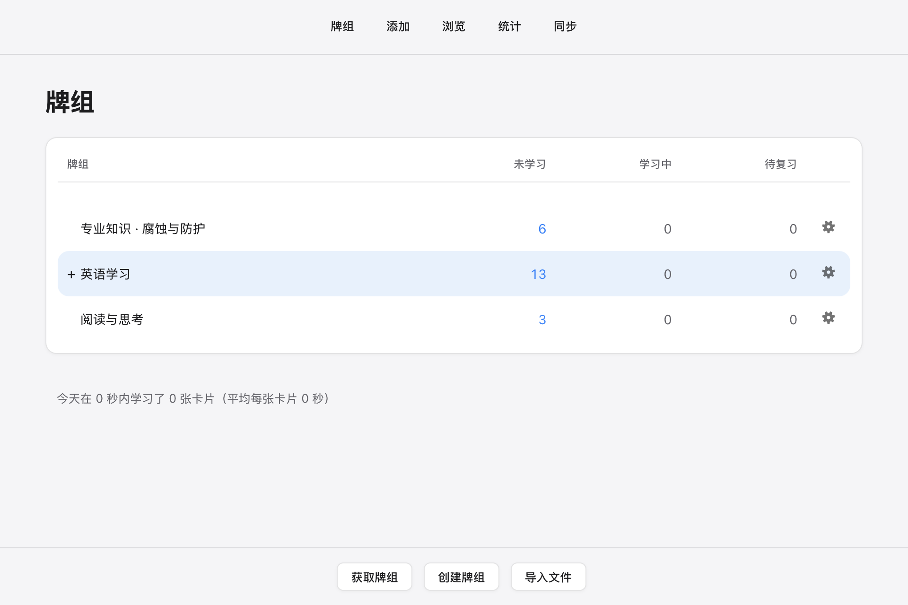
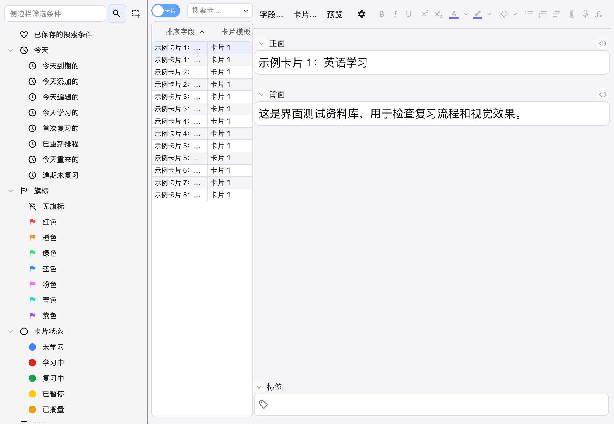
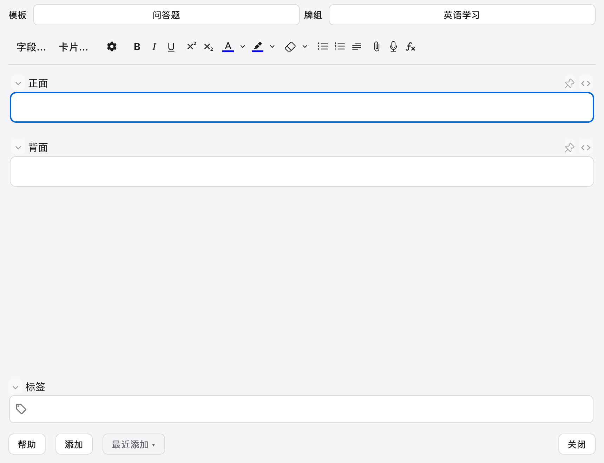
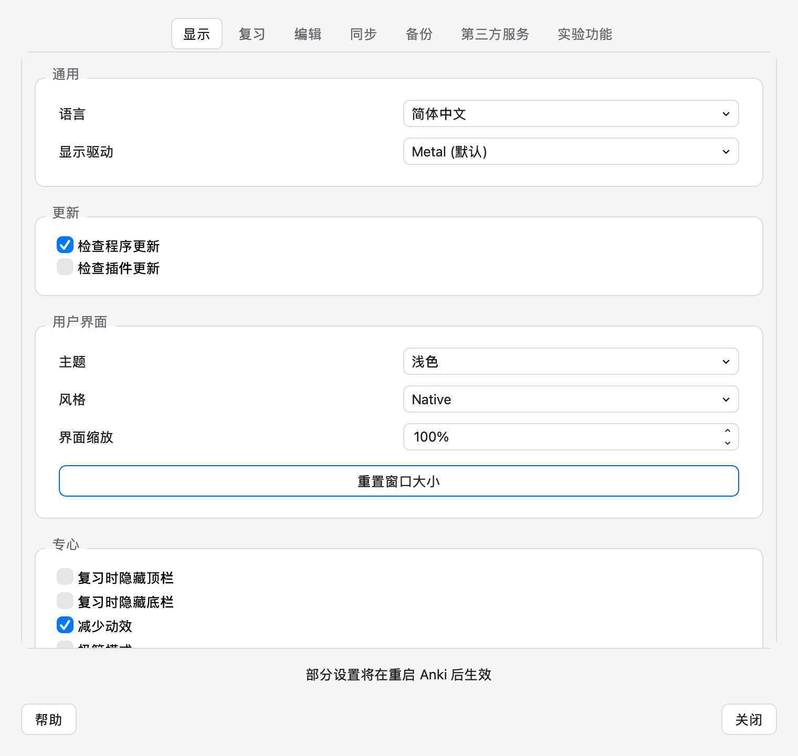

# Anki macOS UI

本分支以官方稳定版 `26.09.4` 为基础，逐步调整桌面界面，核心功能继续跟随 `ankitects/anki`。

以下为独立测试资料库的实际运行截图：




## 第一轮范围

- macOS 系统字体、浅色与深色配色。
- 平整的全宽工具栏，保留原有操作、快捷键、同步状态与插件托盘。
- 牌组首页的标题、分组列表、选中状态、计数对齐和常驻设置入口。
- 牌组学习概览、开始学习按钮、复习页底部操作区。
- 小窗口下调整留白与按钮宽度。

样式只在 macOS 生效。卡片正文、用户模板、调度算法、数据库格式、导入导出和同步实现未修改。原有原生窗口及菜单保留。

## 改动位置

`ts/lib/sass/_macos-app.scss` 集中保存样式，通过五个现有页面样式文件引入；`qt/aqt/deckbrowser.py` 只新增 macOS 首页标题，复用已有翻译。

## 第二轮：跨窗口统一

新增 `qt/aqt/macos_ui.py`，集中管理 Qt 通用控件与内嵌页面的样式，由 `theme.py`、`webview.py` 引入：

- 卡片管理窗口：侧边树、筛选输入框、搜索框、表格、表头与选中状态。
- 新增／编辑窗口：工具栏、字段外框、标签输入、焦点和重复提示；保留字段字体及内容。
- 设置：按钮、下拉框、数值框、分组与标签页；各标签页支持滚动，窗口高度适配屏幕。
- 统计与牌组选项：系统字体、面板、标题、输入框与弹出控件。
- 其他窗口复用同一套通用样式；系统菜单、滚动条、复选框和文件选择框继续使用 macOS 原生控件。

这是统一外观与控件的改造，仍保留上游各窗口的操作结构，没有将所有窗口重写为 SwiftUI。







## 跟随上游

- `origin`：个人 fork。
- `upstream`：`https://github.com/ankitects/anki.git`。
- `main` 保持上游代码；`codex/macos-ui` 保存界面改动。
- 优先合入官方稳定版本标签，而非持续追逐开发版。

更新示例（将标签替换为已发布的目标稳定版）：

```sh
git fetch upstream --tags
git switch codex/macos-ui
git merge <stable-release-tag>
just check
```

合并后用独立测试资料库检查：牌组展开与拖拽、学习概览、显示答案和评分、编辑与导入导出、同步状态、浅色／深色模式、小窗口及常用插件。同步实现未修改不等于可以省略兼容验证。

## 本地开发

遵循上游开发文档，使用 `just run`、`just web-watch` 和 `just check`。开发时使用独立资料库，避免加载日常学习数据。

修改版继续遵守项目的 AGPL-3.0-or-later 及其包含的其他许可证；完整条款见 `LICENSE`。

## 本轮验证（2026-11-17）

- 五个页面样式编译通过。
- 使用本机官方 `26.9.4` 运行时的独立副本，加载本分支界面文件，在独立测试资料库中检查浅色／深色首页、500px 窄窗口、学习概览、复习问题和答案。
- 首页在 960px 和 500px 宽度下均无横向溢出；卡片正文仍使用原模板字体。
- 尚未实测账号同步、插件兼容、导入导出及不同 macOS 版本；这不是正式安装包。
- 已执行上游要求的 `just check`；完整检查停在 Python 环境准备阶段：本机下载镜像配置与上游锁文件不一致，同时锁文件缺少当前项目配置中的部分排除项。未将重新解析的依赖或本机镜像地址纳入本分支，`uv.lock` 保持上游原样。

第二轮额外检查了卡片管理、设置、新增卡片、统计的浅色与深色窗口，以及牌组选项和提示框。编辑器确认使用系统字体且移除了字段阴影；复习问题与答案仍使用模板的 Arial 字体。设置窗口在测试中为 760×720，保留七个标签页及原来的选中页。

Python 静态检查和格式检查通过。`just check` 仍因原有依赖锁定问题未完成；fork 未向官方项目提交代码，贡献者检查使用上游提供的 `CONTRIBUTORS_BYPASS_EMAILS` 参数，没有新增 BSD 授权声明。尚未逐一验证第三方插件、自定义 HTML 及所有导入导出路径。

本机已安装第二轮组件样式，并通过实际应用的设置窗口核对。额外发现：自动化工具读取卡片管理窗口的辅助功能层级时，Qt 的 `libqcocoa` 会在 `NSAccessibility` 调用中崩溃。回退到第一轮安装版（没有本轮通用控件改动）后同样复现，因此不能将其认定为本轮样式引入，也尚未修复。独立资料库中直接运行窗口的截图检查正常；这不等于辅助功能／自动化兼容性已通过验证。
