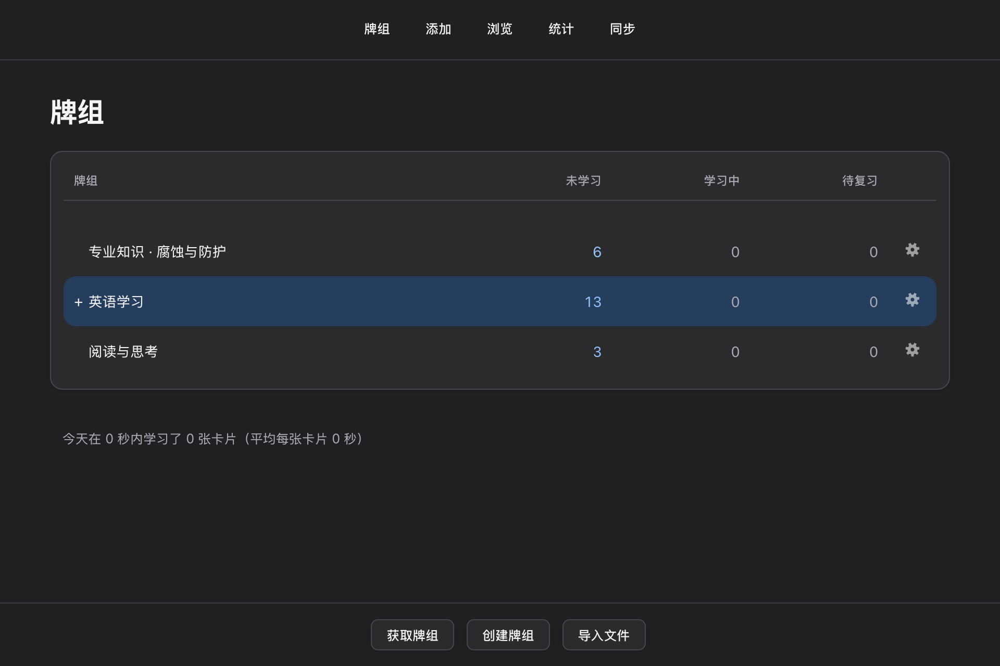

# Anki macOS UI

本分支以官方稳定版 `26.09.4` 为基础，逐步调整桌面界面，核心功能继续跟随 `ankitects/anki`。

以下为独立测试资料库的实际运行截图：




## 第一轮范围

- macOS 系统字体、浅色与深色配色。
- 平整的全宽工具栏，保留原有操作、快捷键、同步状态与插件托盘。
- 牌组首页的标题、分组列表、选中状态、计数对齐和常驻设置入口。
- 牌组学习概览、开始学习按钮、复习页底部操作区。
- 小窗口下调整留白与按钮宽度。

样式只在 macOS 生效。卡片正文、用户模板、调度算法、数据库格式、导入导出和同步实现未修改。原有原生窗口及菜单保留。

## 改动位置

`ts/lib/sass/_macos-app.scss` 集中保存样式，通过五个现有页面样式文件引入；`qt/aqt/deckbrowser.py` 只新增 macOS 首页标题，复用已有翻译。

后续可逐步改进侧边导航、卡片管理窗口与编辑窗口。每一轮先验证现有学习流程和插件入口，再扩大范围。

## 跟随上游

- `origin`：个人 fork。
- `upstream`：`https://github.com/ankitects/anki.git`。
- `main` 保持上游代码；`codex/macos-ui` 保存界面改动。
- 优先合入官方稳定版本标签，而非持续追逐开发版。

更新示例（将标签替换为已发布的目标稳定版）：

```sh
git fetch upstream --tags
git switch codex/macos-ui
git merge <stable-release-tag>
just check
```

合并后用独立测试资料库检查：牌组展开与拖拽、学习概览、显示答案和评分、编辑与导入导出、同步状态、浅色／深色模式、小窗口及常用插件。同步实现未修改不等于可以省略兼容验证。

## 本地开发

遵循上游开发文档，使用 `just run`、`just web-watch` 和 `just check`。开发时使用独立资料库，避免加载日常学习数据。

修改版继续遵守项目的 AGPL-3.0-or-later 及其包含的其他许可证；完整条款见 `LICENSE`。

## 本轮验证（2026-11-17）

- 五个页面样式编译通过。
- 使用本机官方 `26.9.4` 运行时的独立副本，加载本分支界面文件，在独立测试资料库中检查浅色／深色首页、500px 窄窗口、学习概览、复习问题和答案。
- 首页在 960px 和 500px 宽度下均无横向溢出；卡片正文仍使用原模板字体。
- 尚未实测账号同步、插件兼容、导入导出及不同 macOS 版本；这不是正式安装包。
- 已执行上游要求的 `just check`；完整检查停在 Python 环境准备阶段：本机下载镜像配置与上游锁文件不一致，同时锁文件缺少当前项目配置中的部分排除项。未将重新解析的依赖或本机镜像地址纳入本分支，`uv.lock` 保持上游原样。
